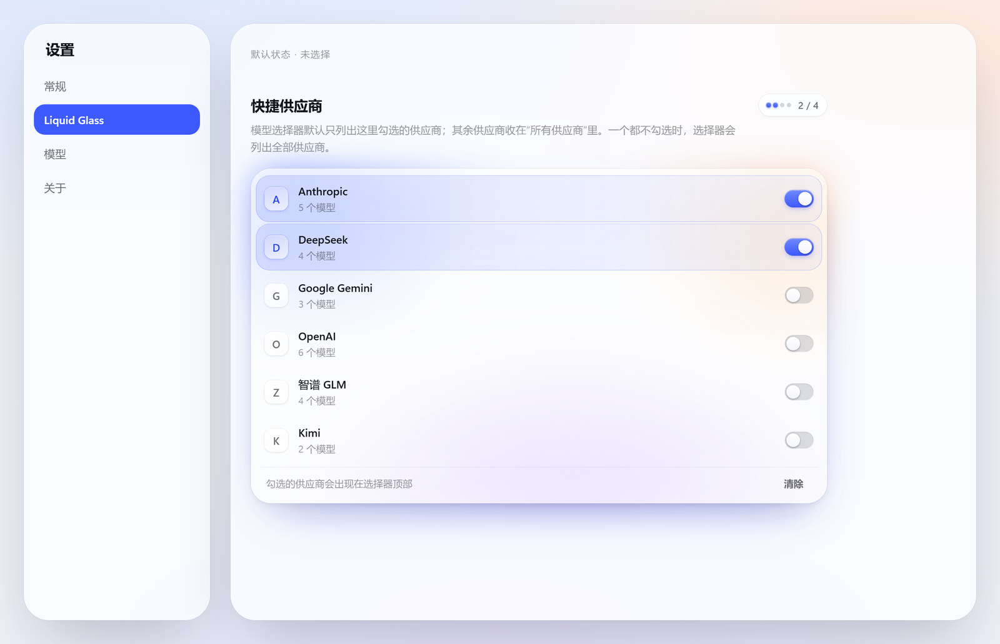
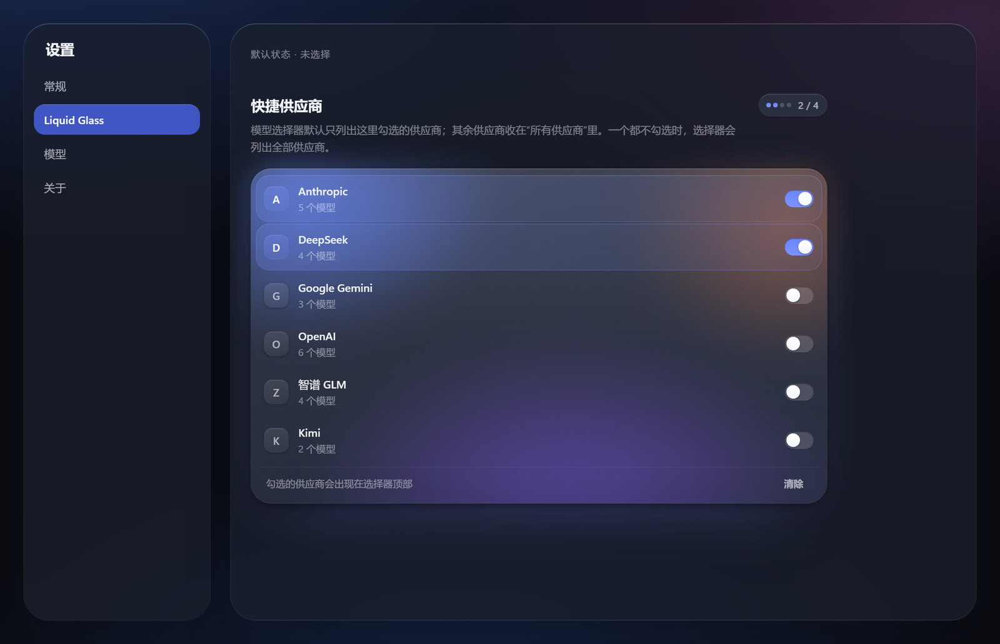
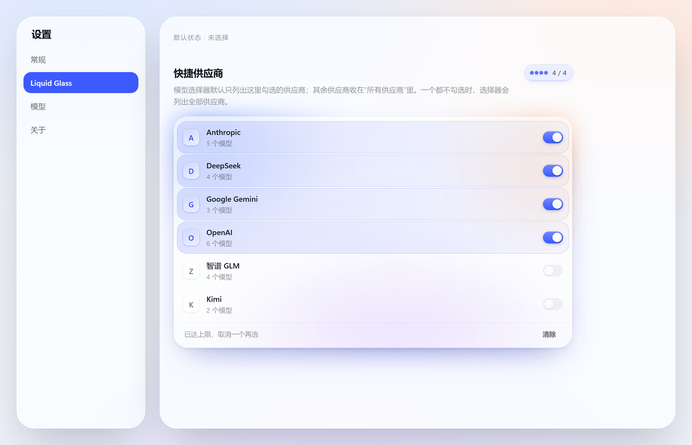

# dsh-glass-theme

An Apple Liquid Glass skin for the DeepSeek Harness Web GUI. Every surface in the
app is redrawn: floating glass chrome over an ambient light field, an opaque
reading surface for the transcript, and one material ladder shared by every
panel, popover and dialog.

Pure CSS plus a ~150-line client runtime. Nothing in the shipped app is patched;
the skin loads as an ordinary Harness bundle and layers its stylesheets after the
app's own.

| Light | Dark |
| --- | --- |
|  |  |



## What it does

- **Re-keys the app's whole token vocabulary.** The shipped theme publishes an
  empty token set, so the palette is CSS-only. `src/css/tokens.css` re-declares
  ~250 `--dsw-*` custom properties on `body` (and `body[data-ds-dark-theme]`),
  which makes every page the skin has never heard of inherit the redesign. It
  also defines 11 properties the shipped build consumes but never defines.
- **Redraws every surface** across 16 sheets: shell, sidebar, conversation,
  composer, overlays, model, picker, stats, settings, pages, workspace,
  widgets, motion.
- **Replaces the composer's model picker.** `src/picker.js` mounts its own React
  card into `conversation.input.model` and hides the host trigger: grouped
  providers, a one-line description per model, the reseller price ratio as a
  badge, a live peak/off-peak chip that follows the SELECTED model's provider
  (DeepSeek: 工作日 9:00–12:00 + 14:00–18:00, ≈2×; 智谱: 工作日 14:00–18:00,
  ≈2×; providers without a schedule show no chip), and an inline effort
  segmented control beside the model list (both visible at once; picking a
  model keeps the card open). Configured providers
  narrow the default list; everything else stays behind one "所有供应商" row.
- **Merges the usage readouts.** `src/stats.js` replaces the two stat pills and
  the context ring with one control that opens a single panel: context pressure
  and its three buckets, session timings, and the token ledger. The pill sits at
  the input box's right edge and the panel hangs off that same right edge.
- **Adds its own settings page** (`settings.section`, "Liquid Glass") where the
  quick-provider list is chosen. The page has one material object — a frosted
  board lit from inside by its own light field (the settings sheet is already
  glass; a second card would be glass on glass) — with a capacity meter, glyph
  tiles, staggered entrance, and etched grain that answers
  `prefers-reduced-transparency`.
- **Adds the 工作空间 workbench** (`src/workspace.js`, sidebar entry `lg-workspace`): a
  whole page answering "what needs me today" across [tapd-ai-cli][tapd] and
  [wecom-cli][wecom] — my TAPD bugs by severity, stories/tasks, WeCom todos,
  an attention list (high severity or overdue), WeCom doc search, in-row
  workflow transitions and owner reassignment, and "start a session here"
  (pick a directory → create workspace → start session). All CLI execution
  goes through the package's own fenced host routes (`/ws/status`, `/ws/run`,
  `/ws/install`: loopback + same-origin fence, subcommand whitelist, `spawn`
  without a shell, timeouts and output caps); a missing CLI degrades to
  clearly-marked demo data with a one-click managed install (`npm i -g
  @wecom/cli`, or a checksum-verified GitHub download into `~/.dsh/bin` for
  tapd). See [docs/WORKSPACE.md](docs/WORKSPACE.md).
- **Answers the accessibility questions**: `prefers-reduced-transparency`,
  `prefers-contrast`, `prefers-reduced-motion`, `hover: none`, and keyboard-only
  focus rings (gated on input modality, so a pointer user never sees one).
- **Styles foreign pages.** Third-party plugins render unclassed HTML into the
  `main` slot; those controls get the app's type and control scale too, without
  reaching into markdown output.

[tapd]: https://github.com/studyzy/tapd-ai-cli
[wecom]: https://github.com/WecomTeam/wecom-cli

## Install

`lib/` is committed, so a clone is ready to load — installing needs no build step.

The [releases page](https://github.com/Ayelsh/dsh-glass-theme/releases) carries
the same build as a prebuilt tarball,
[`dsh-glass-theme.tgz`](https://github.com/Ayelsh/dsh-glass-theme/releases/latest/download/dsh-glass-theme.tgz).
Its name is version-free on purpose, so that URL keeps resolving across
releases; storefronts serve it instead of a build-from-source command.

1. Copy the package into your profile's `node_modules`:

   ```sh
   cp -r . ~/.dsh/profiles/desktop/node_modules/dsh-glass-theme
   ```

2. Add it to that profile's bundle list in `<profile>/package.json`:

   ```json
   { "dsh": { "profile": { "bundles": ["dsh-glass-theme"] } } }
   ```

3. Restart the Harness.

The restart is not optional: the plugin roster is composed from the profile
before the window opens, and the host half (routes, peak-rate cache, usage
ledger) is mounted at boot. Nothing in the shipped app is modified — removing
the folder and the bundle entry restores the stock interface exactly.

## Layout

```
src/css/               the 16 stylesheets, in cascade order
src/client.js          mounts the sheets, tracks modality, wires the layers
src/catalog.js         the model catalogue: providers, families, descriptions, pricing
src/picker.js          the ported model picker (React, mounted into the model slot)
src/stats.js           the merged context/usage panel
src/settings-section.js the skin's settings page
src/workspace.js       the 工作空间 workbench page (tapd + wecom-cli)
src/host/              the host half: routes, peak-rate catalogue, usage ledger, workspace CLI executor
lib/client.js          build output (generated)
lib/host/              build output of src/host (generated)
vendor/                the reference package's data files and assets (MIT, see LICENSE-reference.txt)
tools/                 build + verification tooling
docs/                  feature documents (WORKSPACE.md)
```

## Build and verify

```sh
node tools/verify.mjs       # every selector must resolve against the shipped build
node tools/leak.mjs         # [class*=] must not over-match sibling locals
node tools/build.mjs        # inlines src/css/*.css into lib/client.js, copies the host half
node tools/smoke.mjs        # evaluates the bundle against a stubbed DOM
node tools/assert-built.mjs # the authored rules actually survived into lib/client.js
node tools/host-check.mjs   # the host half registers its routes without throwing
node tools/ws-check.mjs     # the workspace CLI routes: fence, whitelist, probe, caps (mock server)
node tools/ws-render.mjs    # source render smoke test, including explicit open-case handlers
node tools/ws-package-check.mjs dsh-glass-theme-0.2.3.tgz # published bundle regression
```

Live probes (each needs the GUI running; they mint their own auth cookie):

```sh
node tools/two-level.mjs                # the picker's three states: unconfigured, configured, the second card
node tools/settings-page.mjs            # the skin's settings page renders, lists providers, and its switches write
node tools/pick-check.mjs               # one row checked, across providers that share a model id
node tools/effort3.mjs                  # the effort segment applies a level
node tools/picker-rows.mjs              # fail if any row lacks a description or its ratio badge is block-level
node tools/chk-chip.mjs                 # the peak/off-peak chip's state and countdown
node tools/meter.mjs --shot G:/tmp/m    # the context meter panel
node tools/stats-dom.mjs --theme light  # the two stat dialogs
node tools/rail.mjs --scan              # the turn rail's hover previews
node tools/wsselect-probe.mjs           # the native <select> computes an opaque background (popup rows stay readable)
```

`verify.mjs` is the important one. A skin is nothing but selectors, so a wrong
hash prefix or a renamed local is a silently dead rule — no error, no warning,
just a surface that keeps its old look. The tool resolves every token against
`research/shipped-class-map.json` (extracted from the installed app) and fails
the build on a miss.

### The inventories `verify.mjs` resolves against

The app generates its CSS-module class names (`_local_hash`), so the only honest
way to check a selector is against the classes the *installed* build emits. Those
maps are generated, not committed — they contain the app's own stylesheet text,
which is not ours to redistribute. One step each:

```sh
node tools/extract-inventories.mjs --asar "<install>/resources/app.asar"      # shipped classes + attributes
node tools/foreign-inventory.mjs --root ~/.dsh/profiles/desktop/node_modules  # installed plugin classes
```

Both write into `../research/` — one level above the package, so an installed
copy never carries them. `extract-inventories.mjs` auto-detects a local install
when `--asar` is omitted.

`assert-built.mjs` exists because the bundle escapes its own CSS: each sheet is
embedded as a JSON string, so a newline is the two characters `\` `n`. A regex
written against the source file misses in the bundle for that reason alone —
which looks exactly like a lost rule. The tool unescapes once and then asserts
both the rules that must exist and the ones that must not.

## Design rules the sheets follow

1. **A page is a reading surface; a control is glass.** The transcript column is
   opaque on purpose — text that scrolls must never sit on a moving blur. It
   picks up the room's light direction through a very low-alpha gradient instead.
2. **One ladder.** Menus are L2, sheets and dialogs are L3, toasts float. Nothing
   stacks more than two backdrop layers, and nothing is glass on glass.
3. **Large glass gets more fill and less saturation.** A 640px dock at 180%
   saturation turns the ambient field's chroma into a purple wash; the same
   material at 140% reads as glass.
4. **A floating layer earns its float from its own rim.** Over an opaque surface
   there is nothing to blur, so the 0.5px lit top edge and hairline do the work.
5. **Know what to leave alone.** The app's scrollbars, delete-button styling and
   inline-styled third-party controls are already correct; the skin does not
   restyle them.
6. **Never style a control by its ARIA role alone.** The role lands on whatever
   element receives the click, not on the painted shape. `role="switch"` sits on
   an 88×20 toolbar button in the shipped app and on a 530×70 full-width row in
   `dsh-zhipu-plan`; a generic rule painted those rows as accent capsules that
   swallowed their own labels. Style a control when its own class says what it
   is, and let a plugin's own design stand when it does not.
7. **A list row is a member of its group, not a card in it.** When a section
   header already says "these belong together", a plate behind every row redraws
   the group once per row — it is the same statement repeated N times, and it
   eats the row's own horizontal room. Reserve plates for lists of independent
   cards (schedules, goals); for a grouped list use the header, the whitespace
   and one state signal per row.
8. **A state signal goes on the thing that changes state.** The running job row
   is told apart by a tinted command and the primitive's spinner, not by a
   background — a fill would make "running" a surface, which it is not, and
   would leave nothing louder for the row that is actually selected.
9. **Inline styles win, so measure before believing.** The shipped `StateDot`
   sets `width`/`height` inline and renders an SVG spinner for `ongoing` but a
   `::after` dot for every other state. A skin rule cannot resize it, and a
   fixture that hand-writes the markup will happily "prove" a bug that the app
   does not have. Copy the real markup into the fixture, then measure.
10. **A class can name a modifier, not an element.** `xpvNua_fadeTop` is not an
   overlay drawn over the turn rail's ends — it is added to the same div that
   carries `xpvNua_scroller`, so it IS the scroll container. Styling it as if it
   were a separate overlay (`pointer-events: none`) disabled every mark inside
   the rail: it still scrolled, still looked right, and could not be clicked or
   previewed. Read the markup before styling a name.
11. **A shared primitive can reach across sheets.** `[role='tooltip']` is the
   right hook for tooltips and also matches the turn rail's hover preview, which
   is a `role="tooltip"` reading card that brings its own material. The generic
   rule cropped it to a 9px radius and a 4px inset. Scope a primitive with
   `:not([class~='…'])` — and use `~=` there, since a `*=` guard over-matches
   the card's own child classes.
12. **Inject beside a flex column and it becomes a block.** `OptionCopy` is
   `flex-direction: column`, so appending the multiplier badge as a sibling of
   the model name stretched it to the full row width — a 300px grey bar under
   every name. The badge had to go INSIDE the name span. When a decorator adds
   nodes to someone else's React tree, the parent's layout mode decides what the
   node becomes; put it where its shape is already correct.
13. **A wrapping flex row is not a grid.** Six provider chips broke 5+1 across
   two lines, which reads as a mistake and costs the same height a balanced 3+3
   does. `grid-template-columns: repeat(3, minmax(0, 1fr))` gives equal cells, so
   the row scans as one control and every chip is the same target size.
14. **A number needs a reason, not just a state.** 空闲 at 10:00 on a Wednesday
   and 空闲 on 国庆 are different facts, and a weekday-only rule is wrong on the
   ~dozen days a year the reader is most likely to check. The price chip carries
   `data-lg-reason` (法定节假日 / 周末 / absent) so a holiday reads as a holiday
   rather than as a clock that stopped. A year with no holiday table falls back
   to the weekday rule instead of claiming accuracy it does not have.
15. **A card that renders is not a card that works.** A portal mounts outside the
   React tree, a handler can be lost in a port, and `select()` can reject while
   the trigger keeps showing the old model — all invisible in a screenshot.
   `tools/picker-select.mjs` drives a real mouse, asserts the label changed, and
   then puts the model back, because a probe that leaves the user on a different
   model has done damage, not measurement. It reads a row's name from its own
   text nodes: the name span also carries the multiplier badge, so an exact match
   against the trigger label would never hit.
16. **A host half is untested until it has been applied.** `apply()` only runs at
   GUI start, and a throw there can take the whole app down — but the GUI under
   test is the one serving the conversation, so "restart and see" is not a test.
   `tools/host-check.mjs` runs the real `apply(ctx)` against a recording stub and
   asserts the routes it registers; it is what turns a launch-time crash into a
   line of output.
17. **A service must be declared before it can be used.** `ctx.slots` is only an
   accessor when the bundle exports it in `inject`; without `inject: ['slots']`
   the call throws inside a `try`, the page never appears, and nothing is logged
   where a user would look. A slot's own `inject` is an INJECTOR FUNCTION, not a
   list — an array registers a section that renders nothing and reports nothing.
18. **An entry at the end of a scroll is an entry most users never see.** The
   effort row and the "所有供应商" door were rows inside the scrolling body, so
   they sat ~1300px below the viewport once a 28-model provider was listed. They
   moved into a footer outside the scroll area: a control is not the last row of
   a table.
19. **A projection is not the store.** `projections.faceOf('modelSelection')`
   returns a flattened summary with no `groups`; the provider list only exists on
   `ctx.get('modelDirectories').directoryFor(session).store.getSnapshot()`. The
   picker already read it the second way, which is why the composer showed six
   providers while the settings page showed none.
20. **A native `<select>` popup is painted from the control, not the page.** Write
   the options, style the rows, and click it. Chrome fills the open list with the
   `<select>`'s own background and copies a transparent one verbatim — no themed
   fallback (`internal_popup_menu.cc`) — so a control whose background token does
   not resolve opens a white list of dark-theme text: every option present and
   unreadable. `color-scheme: dark` does not help; it only reaches the controls
   the browser draws itself (checkboxes, scrollbars, date pickers). The two rules
   that do are an opaque `background-color` on the select and an explicit
   `option { background-color; color }`, which the popup honours per row. A
   screenshot of the closed control proves nothing here — 0.3.1 shipped a
   dropdown whose options only became invisible after the click.
21. **A child process gets a closed stdin, always.** `spawn` defaults to a pipe
   for stdin that nobody writes and nobody ends. Any CLI command that reads it
   (`tapd bug update`, `story update`) blocks forever, so the 25 s timeout kills
   it and the UI reports `退出码 1` with empty stdout, empty stderr — a failure
   with no evidence. Measured on tapd 1.0.0: 0.5 s with `stdio: ["ignore", …]`,
   never returns with the default pipe. Reading commands hide the bug because
   they never touch stdin; only writes hand the user a blank error.
22. **A `<button>` with an empty `onClick` is a lie, and a helper outside the
   component cannot close over its state.** The four focus cards were real
   buttons, styled with hover, wired to nothing — the panel looked broken without
   saying so. The first fix referenced `setTab` from a helper defined outside the
   component, so every click threw `ReferenceError: setTab is not defined` and the
   page sat still: an exception is not a no-op, but it reads like one. Pass the
   setter in, and give the render test the same source-level assertion that the
   click path you just wrote is the one in the file.
23. **Display normalisation must not reach the write path.** TAPD stores multiple
   owners as `甲;乙`, and the mapped `owner` was tidied to `甲, 乙` for the row
   meta. The 转派 dialog prefilled that tidied string and sent it back unchanged,
   so one click turned two owners into a single owner literally named `甲, 乙`
   (verified on bug `1145368483001012673`, then restored). Keep the raw value
   beside the display value, prefill with the raw one, and convert separators only
   when the user actually typed them.

24. **A control that lives only inside a transient banner disappears with the
   banner.** The TAPD project `<select>` lived in the login banner, and the banner
   folded itself away exactly when a project was configured — so the control that
   changes projects vanished at the moment a project first existed. Instruments
   the user needs repeatedly belong in permanent chrome (the toolbar switcher),
   not in a surface that exists to ask for something once. Check the empty state
   and the filled state separately: a banner is allowed to be absent, a switch is
   not.
25. **Glass is a material for instruments, not for lists.** The pane is opaque
   and scrolls; one static ambient light field sits behind it (`.lgws-ambient`,
   blurred radial gradients, `aria-hidden`); the toolbar pill, project menu,
   count cards and dialogs float over that field with `backdrop-filter: blur()
   saturate()` plus a translucent fill, a 0.5px top specular and a 0.5px hairline.
   Rows, inputs and search fields stay opaque: frosting dense text costs
   legibility and buys nothing. Concentric radii (`inner = outer − padding`),
   press feedback 0 ms in and eased out, and real answers for
   `prefers-reduced-transparency`, `prefers-contrast` and `prefers-reduced-motion`
   — a sheet that ignores them is a screenshot, not an interface.
